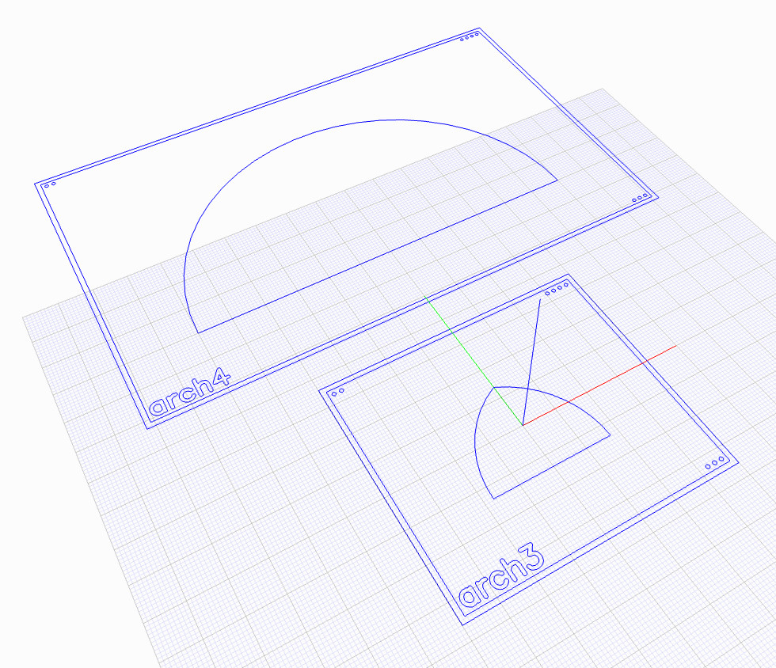
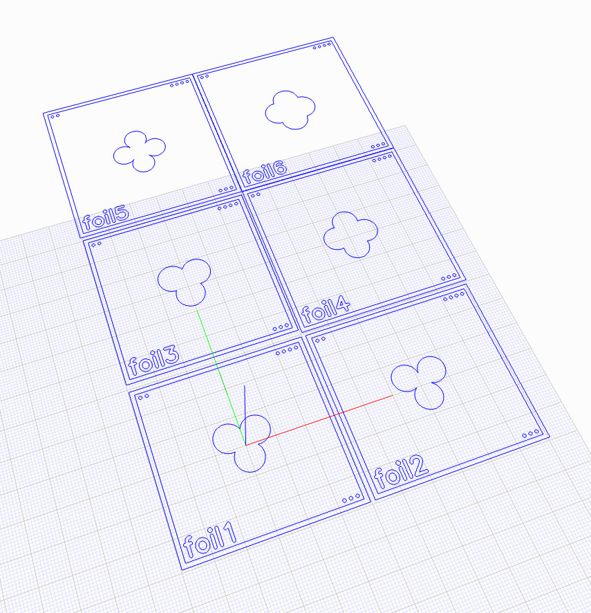
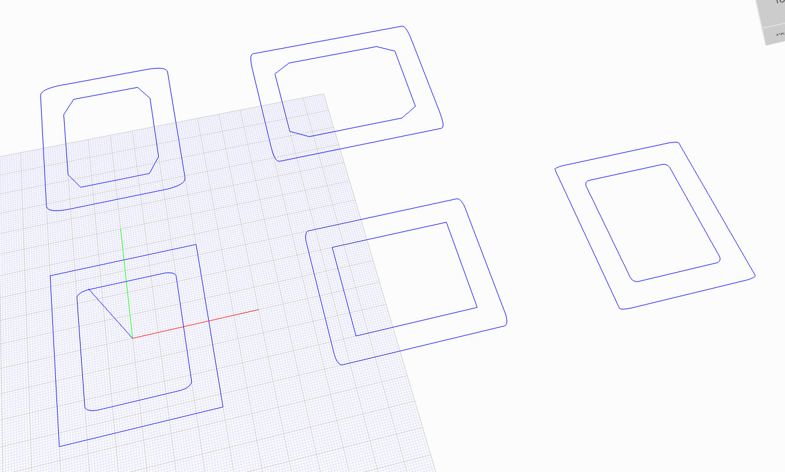
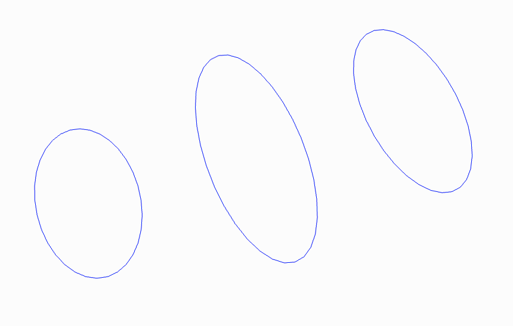
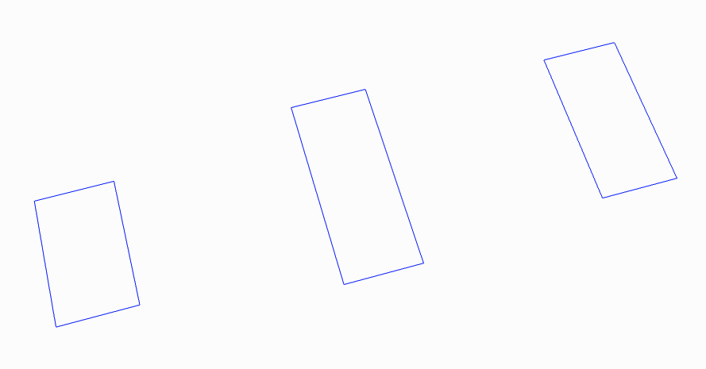
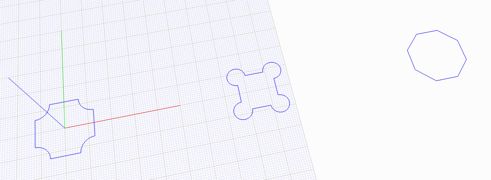
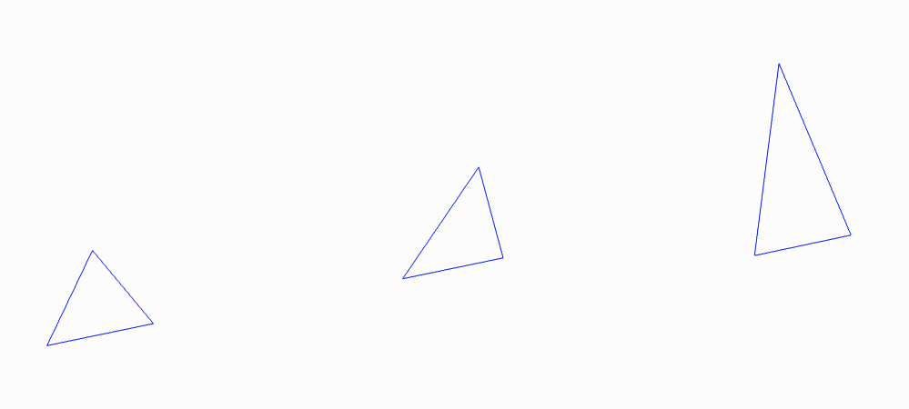
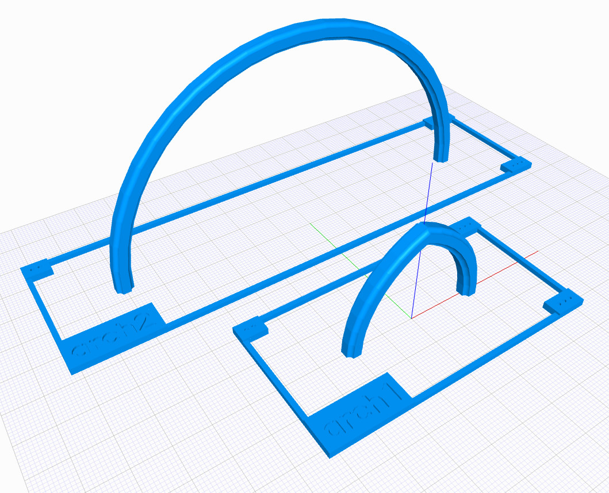
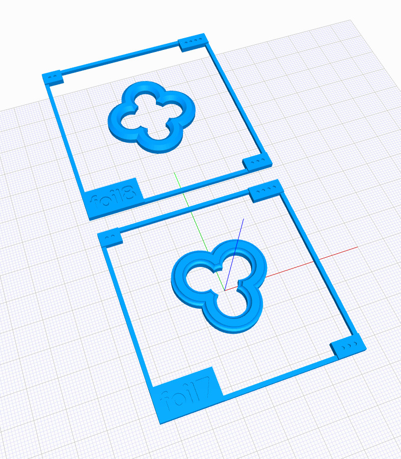
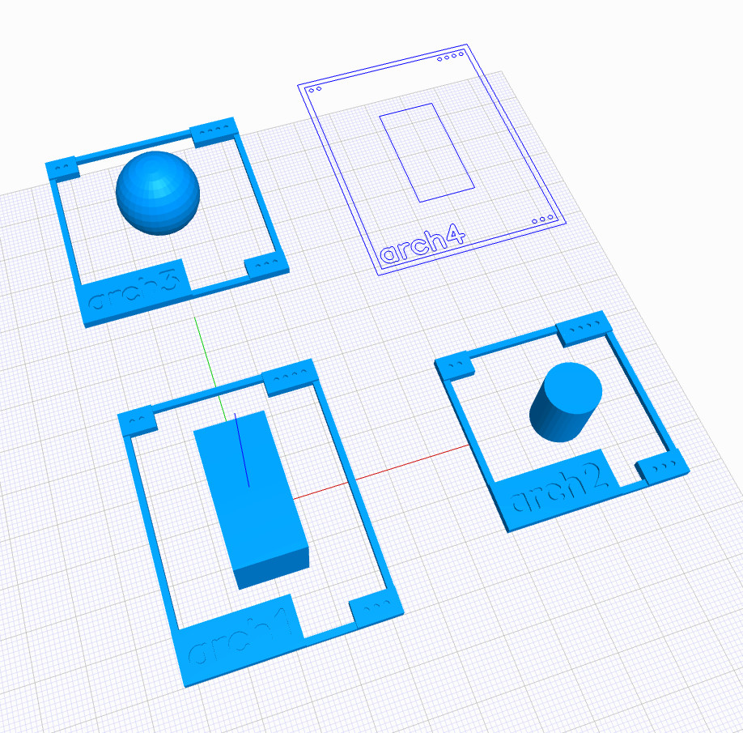

# swcad-js-helpers

Various helper functions for the SWCAD-JS sytem.

Also some useful prototypes that may eventually be "promoted" to the main library.

---

## SWCAD-JS Helpers API

SWCAD-JS Helper functions and utilities.

---

 

### DATA

Mostly math constants and common dimensions/options.

---

### data.constants

Numeric constants and ratios.

---

### data.functions

Functions that support data initialization and access.

#### camelCase(str)

Converts the given string to camel case, using spaces/whitespace as delimiters.

#### constantToCamelCase(str)

Converts constant-style strings (capitals w/ underscores) to camel case.

---

### data.standards

Dimensions and options used throughout the SWCAD-JS system.

---

 

### CALCS

Math calculations and basic JSCAD operations.

---

### calcs.position

Functions leveraging JSCAD to get position data or move 2D/3D geometries.

---

### calcs.position.rectangle

Calculations around rectangle positions.

#### getRectangleCoords(rectGeom)

Gets 3D bounding coordinates for a given rectangle.

#### getRectangleCorners(rectGeom)

Gets 3D bounding corners for a given rectangle.

---

### calcs.geometry

Geometric calculations in 2D/3D space.

---

### calcs.geometry.triangle

Geometric calculations for triangles.

#### rightTriangleOpts(opts)

Sets up triangle creation from the given parameters. If valid, returns triangle creation strategy (AAS, ASA, SAS, etc) and values for `jscad.primitives.triangle()`. If invalid, returns `null`.

---

 

### PROFILES

Modelling functions that generate 2D geometries.

---

### profiles.arch

Modelling functions for 2D arches.

#### onePtArch(opts)

Generates a one-centre (semicircular) arch.

#### twoPtArch(opts)

Generates a two-centre pointed arch.

---

### profiles.curve

Modelling functions for curves.

---

### profiles.curve.rightCorner

Modelling functions for right-angle corner curves.

#### bronze(opts)

Generates a right-angle corner curve with axis lengths corresponding to the Bronze ratio.

#### copper(opts)

Generates a right-angle corner curve with axis lengths corresponding to the Copper ratio.

#### golden(opts)

Generates a right-angle corner curve with axis lengths corresponding to the Golden ratio.

#### plastic(opts)

Generates a right-angle corner curve with axis lengths corresponding to the Plastic ratio.

#### silver(opts)

Generates a right-angle corner curve with axis lengths corresponding to the Silver ratio.

#### sixtyThirty(opts)

Generates a right-angle corner curve with axis lengths corresponding to a 30-degree right triangle's sides.

#### superGolden(opts)

Generates a right-angle corner curve with axis lengths corresponding to the Super-golden ratio.

---

### profiles.foil

Modelling functions for 2D "foils" (geometric shapes formed by overlapping circles) such as trefoils, quatrefoils, cinquefoils, etc.

#### cinquefoil(opts)

Generates a cinquefoil outline.

#### octofoil(opts)

Generates an octofoil outline.

#### quatrefoil(opts)

Generates a quatrefoil outline.

#### sexfoil(opts)

Generates a sexfoil outline.

#### trefoil(opts)

Generates a trefoil outline.

---

### profiles.rectFrame

Modelling functions for rectangular frames with various corner options.

#### rectangularFrame(opts)

Generates a rectangular frame with the given corner options (interior and exterior).

---

### profiles.shapes

Modelling functions for various basic shapes.

---

### profiles.shapes.polygons

Modelling functions for various polygons.

#### octFromDiam(opts)

Generates an octagon from a given diametre.

---

### profiles.shapes.ellipse

Modelling functions for various ellipses.

#### bronze(opts)

Generates an ellipse with axis lengths corresponding to the Bronze ratio.

#### copper(opts)

Generates an ellipse with axis lengths corresponding to the Copper ratio.

#### golden(opts)

Generates an ellipse with axis lengths corresponding to the Golden ratio.

#### plastic(opts)

Generates an ellipse with axis lengths corresponding to the Plastic ratio.

#### silver(opts)

Generates an ellipse with axis lengths corresponding to the Silver ratio.

#### sixtyThirty(opts)

Generates an ellipse with axis lengths corresponding to a 30-degree right triangle's sides.

#### superGolden(opts)

Generates an ellipse with axis lengths corresponding to the Super-golden ratio.

---

### profiles.shapes.rectangle

Modelling functions for various rectangles.

#### bronze(opts)

Generates a rectangle with side lengths corresponding to the Bronze ratio.

#### copper(opts)

Generates a rectangle with side lengths corresponding to the Copper ratio.

#### golden(opts)

Generates a rectangle with side lengths corresponding to the Golden ratio.

#### plastic(opts)

Generates a rectangle with side lengths corresponding to the Plastic ratio.

#### silver(opts)

Generates a rectangle with side lengths corresponding to the Silver ratio.

#### sixtyThirty(opts)

Generates a rectangle with side lengths corresponding to a 30-degree right triangle's sides.

#### superGolden(opts)

Generates a rectangle with side lengths corresponding to the Super-golden ratio.

---

### profiles.shapes.square

Modelling functions for various squares.

#### cornerCircNotch(opts)

Square with circular notches at corners.

#### cornerCircles(opts)

Square with circles at corners.

---

### profiles.shapes.triangle

Modelling functions for various triangles.

#### equilateral(opts)

Generates an equilateral triangle.

#### right30(opts)

Generates a right triangle with a 30-degree angle.

#### right45(opts)

Generates a right triangle with a 45-degree angle.

#### rightBronze(opts)

Generates a right triangle with side lengths corresponding to the Bronze ratio.

#### rightCopper(opts)

Generates a right triangle with side lengths corresponding to the Copper ratio.

#### rightGolden(opts)

Generates a right triangle with side lengths corresponding to the Golden ratio.

#### rightSilver(opts)

Generates a right triangle with side lengths corresponding to the Silver ratio.

---

 

### COMPONENTS

Modelling functions that generate 3D geometries.

---

### components.arch

Modelling functions for 3D arches. Input 2D profiles must be centred at [0, 0, 0].

#### onePtArch(opts, geomProfile)

Generates a one-centre (semicircular) arch using a given 2d cross-section profile.

#### twoPtArch(opts, geomProfile)

Generates a two-centre pointed arch using a given 2d cross-section profile.

---

### components.foil

Modelling functions for 3D "foils" (geometric shapes formed by overlapping circles) such as trefoils, quatrefoils, cinquefoils, etc. Input 2D profiles must be centred at [0, 0, 0].

#### cinquefoil(opts, geomProfile)

Generates a cinquefoil opening using a given 2d cross-section profile.

#### octofoil(opts, geomProfile)

Generates an octofoil opening using a given 2d cross-section profile.

#### quatrefoil(opts, geomProfile)

Generates a quatrefoil opening using a given 2d cross-section profile.

#### sexfoil(opts, geomProfile)

Generates a sexfoil opening using a given 2d cross-section profile.

#### trefoil(opts, geomProfile)

Generates a trefoil opening using a given 2d cross-section profile.

---

 

### UTILS

Various utility helpers, mainly for the final modelling output.

---

### utils.colors

A set of named colour presets and their translucent versions. References color palette from Material Design (`https://www.google.com/design/spec/style/color.html`)

---

### utils.layout

Utilities for arranging sets of 2D/3D geometries into various layouts, with additional options for rendering text labels and descriptions.

#### addToLayout(opts, geom)

Adds element to the layout.

#### clearLayout(opts)

Clears all the layout elements.

#### gridLayout(opts)

Renders a grid layout.

#### linearLayout(opts)

Renders a linear layout.

#### removeFromLayout(opts)

Removes an element with the given ID from the layout.

---

### utils.palette

Collections of colour presets grouped into palettes. References color palette from Material Design (`https://www.google.com/design/spec/style/color.html`)
